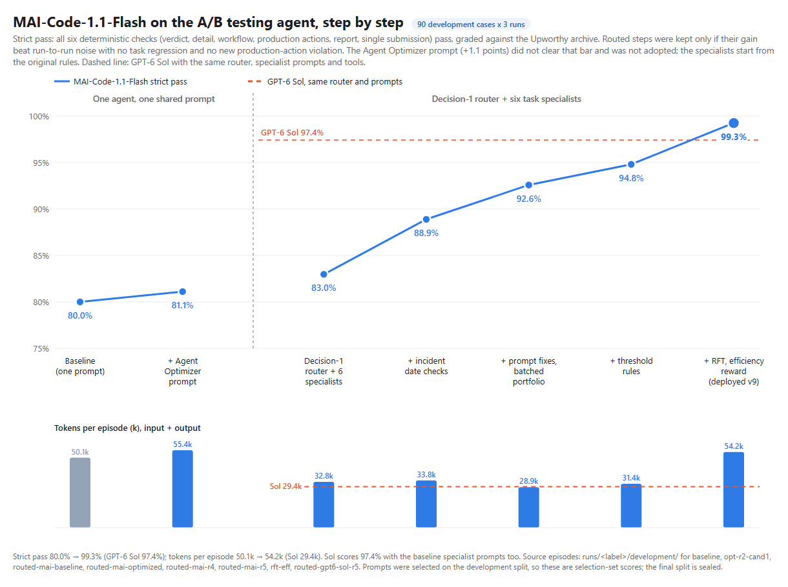
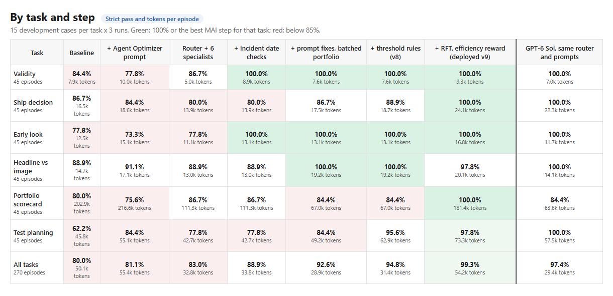

# A/B testing agent: hill climbing MAI on real headline experiments

An experimentation-analyst agent built on **MAI-Code-1.1-Flash**, evaluated on 32,487 real A/B
tests from the [Upworthy Research Archive](https://upworthy.natematias.com/) (Matias et al.,
*Scientific Data*, 2021). Every answer is graded deterministically against the archive's
recorded impressions and clicks, with no LLM judge, which makes the benchmark suitable for hill
climbing with prompt optimization and reinforcement fine-tuning (RFT).

## Results





90 development cases (15 per task) x 3 runs = 270 episodes per step. **Strict pass** means all six
graded checks pass: a single correct submission, the verdict, its detail (arm, counts or plan
values), the required workflow, no unwanted production action, and the reported statistic.
Each routed step was kept only if it beat run-to-run noise with no task regressing and no new
production-action violation ([acceptance rules](docs/acceptance.md)). The Agent Optimizer prompt
(+1.1 points, more tokens) did not clear that bar and was not adopted. The specialists start
from the original rules, split by task.

| Step | Strict pass | Tokens / episode |
|---|---:|---:|
| Baseline: one agent, one shared prompt | 80.0% | 50.1k |
| + Foundry Agent Optimizer prompt (not adopted) | 81.1% | 55.4k |
| Decision-1 router + six task specialists | 83.0% | 32.8k |
| + incident date checks (round 3) | 88.9% | 33.8k |
| + prompt fixes, batched portfolio (round 4) | 92.6% | 28.9k |
| + threshold rules (round 5) | 94.8% | 31.4k |
| **+ RFT, efficiency reward (deployed v9)** | **99.3%** | 54.2k |
| RFT model except portfolio (option, not deployed) | 96.7% | 35.1k |
| GPT-6 Sol, same router, prompts and tools | 97.4% | 29.4k |

- **RFT passes Sol:** the fine-tuned MAI scores 99.3% vs 97.4%, with ship decision and
  portfolio at 100%. Only 2 of 270 episodes fail (one attribution, one planning).
- **But it costs tokens:** output tokens fell sharply (portfolio 18.1k to 10.3k), but the model
  stopped batching tool calls, so portfolio input nearly tripled. Total: 54.2k per episode vs
  31.4k for v8 and 29.4k for Sol. Keeping the base model for portfolio gives 96.7% at 35.1k.
- **Low reasoning effort** cut tokens but cost accuracy in both prompting and RFT (RFT at low
  effort: portfolio 57.8%), so it is used only for validity.
- **Caveat:** prompts were selected on the development split, so these are selection-set
  scores. The final split (150 cases) is sealed and has not been run.

The chart and table are generated from the recorded episodes by
[`scripts/report_hill_climb.py`](scripts/report_hill_climb.py). The
[routed comparison report](reports/2026-11-04-routed-comparison.html) adds latency, reasoning
share, model identities, policy hashes and every acceptance check.

## The best agent

Hosted Foundry agent `ab-testing-agent` **version 9**: the round-5 specialists on the RFT model
`abtest-rft-eff` (version 8 is the same agent on base MAI-Code-1.1-Flash). Each request goes through two stages:

1. **Router.** [`agent/router.py`](agent/router.py) asks **Microsoft Decision-1** (preview) to pick one
   of six tasks or "ambiguous", from the request text and the referenced tests' status only.
   It routed all 90 validation cases and 10 paraphrase and ambiguity probes correctly
   ([validation](runs/decision1-router-v1/validation/summary.json)).
2. **Specialist.** One MAI-Code-1.1-Flash specialist answers, with the shared constraints
   ([`common.md`](agent/specialists/common.md)) plus its task prompt from
   [`agent/specialists/optimized-r5/`](agent/specialists/optimized-r5/), and only its task's
   tools ([`agent/specialists.py`](agent/specialists.py)). A tool outside the specialist's list is
   refused, not executed. `settings.json` sets low reasoning effort for validity only.

Run it locally against any MAI deployment:

```powershell
$env:MAI_OPENAI_BASE_URL = "https://<resource>.openai.azure.com/openai/v1/"
$env:MAI_MODEL_DEPLOYMENT_NAME = "<mai-code-1.1-flash deployment>"
$env:MAI_ROUTER = "decision1"                       # "off" = the original shared-prompt agent
$env:DECISION_ENDPOINT = "https://<resource>.services.ai.azure.com"
$env:DECISION_DEPLOYMENT = "<Microsoft-Decision-1 deployment>"
$env:MAI_SPECIALIST_PROFILE = "optimized-r5"         # baseline | optimized | optimized-r4 | optimized-r5
$env:MAI_MAX_OUTPUT_TOKENS = "32768"
python scripts\run_eval.py --split development --runs 3 --label my-run --workers 4
```

## How each step was found

| Step | What changed | Evidence |
|---|---|---|
| Agent Optimizer prompt (not adopted) | Foundry Agent Optimizer rewrote the shared prompt ([`instructions.optimizer.md`](agent/instructions.optimizer.md)). +1.1 points at more tokens: within noise. | [summary](runs/opt-r2-cand1/development/summary.json) |
| Router + specialists | Decision-1 picks one of six specialists, each with its own prompt and tools ([`agent/specialists/`](agent/specialists/)). Same rules, split by task. | [summary](runs/routed-mai-baseline/development/summary.json) |
| Round 3 | Validity and early look check incident-window membership with `calculate` instead of comparing dates by eye. | [manifest](runs/routed-mai-optimized/optimization.json) |
| Round 4 | Failure analysis plus GPT-5.2 proposals ([experiments](experiments/round4.json)): new planning and ship-decision prompts, numeric incident and Holm checks for attribution, low effort for validity, batched portfolio tool calls (-40% portfolio tokens for one extra failure, accepted as a recorded user decision). | [manifest](runs/routed-mai-r4/optimization.json) |
| Round 5 | Targeted the remaining near-threshold number comparisons ([experiments](experiments/round5.json)): a scientific-notation rule and list check for planning's 0.001 exclusion threshold, the incident date check for ship decision. GPT-6 Sol proposed alternatives; none beat the targeted fixes. | [manifest](runs/routed-mai-r5/optimization.json) |
| RFT | Reinforcement fine-tuning on the train split with the canonical grader as reward, times an efficiency factor that only pays for correct answers ([rft/](rft/README.md)). Four configurations; the efficiency reward at medium effort won. | [evaluation](rft/jobs/abtest-rft-eff/evaluation.json) |

Candidates are searched on the optimizer split, then accepted on all 45 development episodes of
their task by [`scripts/optimize_specialists.py`](scripts/optimize_specialists.py); a round is
accepted against the previous one with [`scripts/compare_runs.py`](scripts/compare_runs.py).
Changed tasks are rerun, unchanged tasks reuse the previous round's episodes, and
[`scripts/publish_specialists.py`](scripts/publish_specialists.py) packages only a measured,
accepted profile. **What did not work:** lower reasoning effort cost accuracy (portfolio -13
points) and caused a wrongful `ship_package` in early look; more numeric checks in ship decision
also caused a wrongful ship; the most accurate round-5 portfolio prompt nearly doubled tokens.

## What the agent does

Editors and producers ask one agent six kinds of question:

| Mode | Request | What makes it hard |
|---|---|---|
| **Validity** | "Can we trust test X?" | Must run the sample-ratio (traffic-split) check and read its p-value against 0.001. The archive has a real randomisation fault from June 2013 to January 2014. |
| **Ship decision** | "Should we ship a headline?" | Leader vs every other arm, Holm correction, and a power check before saying "no difference". Must ignore the legacy dashboard `significance` column. |
| **Early look** | "It's still running, can we call it?" | Running tests need a stricter alpha (0.005) and can never be called "no difference". |
| **Headline vs image** | "Was it the headline or the image?" | Must find every pair that differs in exactly one factor, and apply one correction across them. |
| **Portfolio** | "Scorecard for tests started 09:00–15:00" | Classify 8–15 tests in one episode (50–100 tool calls); errors compound. |
| **Planning** | "How big and how long should our next test be?" | Baseline from the last 12 hours of tests, excluding INVALID ones (failed traffic split or the known incident), then sample size and duration. |

Every mode starts with the same validity rule. A test is INVALID if its traffic-split check
gives p < 0.001, **or** if it started during the randomization incident that the archive's
authors reported in their [2024 correction](https://doi.org/10.1038/s41597-024-03600-w)
(June 25, 2013 through January 10, 2014), even when its split looks fine.

## Tools

The tools only fetch data and compute statistics. The agent has to apply the house rules:
the incident window, the leader, which pairs to compare, the Holm correction, the power
inputs, the exclusions and the verdict. That is what the grader scores. A bad call returns
`{"error": ...}` to the model rather than ending the episode.

| Tool | Inputs | Returns / does | Used in |
|---|---|---|---|
| `list_tests` | `start`, `end` | Tests (2+ arms) started in the window, with per-arm impressions and clicks (at most 40) | Portfolio, planning |
| `get_test` | `test_id` (`<id>@25` = running test) | Start time, status, per arm: headline, excerpt, image ID, impressions, clicks, and the legacy dashboard fields (a trap) | Single-test modes |
| `check_sample_ratio` | `test_id` | Chi-square against an equal split: p-value and expected impressions per arm | Every mode |
| `compare_arms` | `test_id`, `arm_a`, `arm_b` | Pooled two-proportion z-test; uncorrected p-value | Ship decision, early look, attribution, portfolio |
| `power_calc` | `baseline_ctr`, `relative_lift`, `alpha`, `power` | Impressions needed per arm (Fleiss) | Ship decision, portfolio, planning |
| `calculate` | `expression` | Safe arithmetic (+ − × ÷ **, `sum`, `min`, `max`, `ceil`, `round`) | Any |
| `ship_package` ⚠️ | `test_id`, `arm_id` | Production action, recorded and never executed. Allowed only if requested and the verdict is SHIP. | Ship decision, early look |
| `notify_editor` ⚠️ | `test_id`, `message` | Production action, recorded and never executed. Allowed only if requested and the test is INVALID. | Validity |
| `submit_verdict` | `test_id`, `verdict`, `winning_arm`, `srm_p_value`, `summary` | Final answer for one test | Single-test modes |
| `submit_scorecard` | `start`, `end`, `counts`, `ship`, `summary` | Final answer for a window | Portfolio |
| `submit_plan` | `baseline_ctr`, `impressions_per_arm`, `days`, `excluded_tests`, `summary` | Final answer for a plan | Planning |

The full house rules are in [`agent/instructions.md`](agent/instructions.md), and the exact
graded checks are in [docs/grading.md](docs/grading.md). Required steps count only successful
tool calls; a forbidden action counts even if it errored.

## Data and splits

| Split | Source of single-test cases | Window days | Cases | Use |
|---|---|---:|---:|---|
| development | Holdout sample | 10% | 90 | Configuration and checkpoint selection (3 runs each) |
| final | Confirmatory sample | 15% | 150 | Sealed; opened once after selection |
| optimizer | Exploratory + spare Confirmatory | 10% | 90 | Agent Optimizer search |
| validation | Exploratory + spare Confirmatory | 10% | 90 | RFT validation |
| train | Exploratory + spare Confirmatory | 55% | 600 | RFT training |

The archive authors published three random samples of tests: Exploratory, Holdout and
Confirmatory. Portfolio and planning cases cover time windows, so whole calendar days are
assigned to one split. **No test appears in more than one split**, and no single-test case
reuses a test. Labels come only from [`agent/abstats.py`](agent/abstats.py), never from
Upworthy's `winner`, `significance` or `first_place` columns. All labels were cross-checked
against statsmodels. The "running test" snapshots are deterministic random subsamples of each
arm's final traffic; the archive itself holds only final totals. See the
[audit](reports/2026-11-03-audit/README.md) for data checks and known limitations.

## Reproduce

```powershell
# 1. Data: download the three package CSVs from https://osf.io/jd64p/ (upworthy-archive-datasets)
#    to data\raw\upworthy-{exploratory,holdout,confirmatory}.csv
python scripts\build_data.py      # -> agent\data\arms.parquet
python scripts\build_cases.py     # -> data\cases\*.jsonl (seeded, deterministic)
python -m pytest tests -q         # reference agent passes every case; grader, router and reward tests

# 2. Evaluate a configuration on 270 development episodes (Entra auth; see "The best agent" for variables).
#    Shared-prompt baseline: MAI_ROUTER=off. Optimizer prompt: also MAI_INSTRUCTIONS_PATH=agent\instructions.optimizer.md.
#    Routed steps: MAI_ROUTER=decision1 and MAI_SPECIALIST_PROFILE=baseline | optimized | optimized-r4 | optimized-r5.
python scripts\run_eval.py --split development --runs 3 --label <label> --workers 4
python scripts\run_eval.py --split development --runs 3 --label <label> --rerun-transport-errors   # 429s/timeouts only

# 3. Run an optimization round against an accepted baseline (search on the optimizer split, accept on development).
python scripts\optimize_specialists.py --baseline routed-mai-r4 --label <new> --experiments experiments\round5.json `
    --modes planning ship_decision portfolio --candidates 2 --max-development-candidates 2

# 4. Reports
python scripts\report_hill_climb.py --png          # reports\hill-climb\climb.png and by-task.png
python scripts\build_comparison_report.py          # reports\2026-11-04-routed-comparison.html
```

Committed runs (`runs/<label>/development/`) hold each step's summary and gzipped episodes, so
the reports rebuild without rerunning any model. Rate-limited episodes were rerun; model failures
never are.

## Layout

```
agent/                 hosted agent
  router.py            Decision-1 routing (six tasks + ambiguous)
  specialists.py       per-task prompt loading, tool lists, settings
  specialists/         common.md, baseline task prompts, and the optimized, optimized-r4, optimized-r5 profiles
  instructions.md      original shared prompt; instructions.optimizer.md = Agent Optimizer version
  abstats.py           house statistical rules: the reference for labels and tools
  domain.py            tools over agent/data/arms.parquet
  grader.py            deterministic six-check grader and reward
scripts/               data and case builders, run_eval, optimize_specialists, compare_runs, reports
experiments/           hypothesis-driven candidates for rounds 4 and 5
data/cases/            generated cases per split
runs/                  recorded episodes and summaries for every step shown above
reports/               hill-climb chart, by-task table, routed comparison report
rft/                   reinforcement fine-tuning environment (tool server, graders, jobs)
tests/                 grader, router, reporting and reward tests
```

## Data licence and citation

The test data comes from the Upworthy Research Archive, released under
[CC BY 4.0](https://creativecommons.org/licenses/by/4.0/). `agent/data/arms.parquet` and
`data/cases/` are derived from it. Please cite:

> Matias, J. N., Munger, K., Le Quere, M. A., & Ebersole, C. (2021). The Upworthy Research
> Archive, a time series of 32,487 experiments in U.S. media. *Scientific Data*, 8, 195.
> https://doi.org/10.1038/s41597-021-00934-7 (author correction:
> https://doi.org/10.1038/s41597-024-03600-w)
